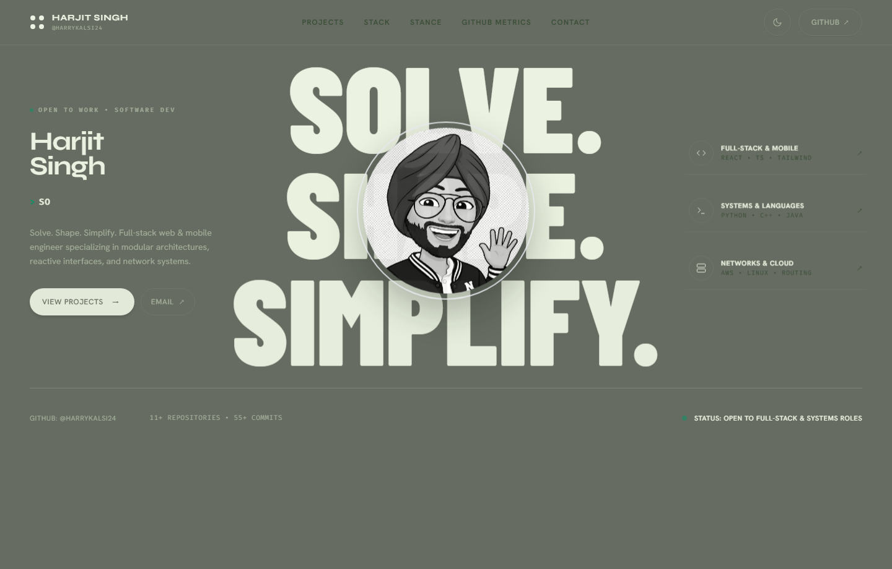
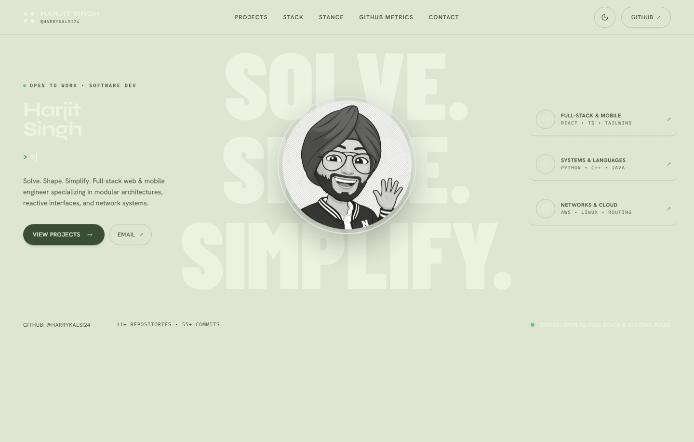

# Harjit Singh — Editorial Engineering Portfolio ("Myself")

[](https://harrykalsi24.github.io/Myself/)
[](https://harrykalsi24.github.io/Myself/)
[](https://github.com/Harrykalsi24/Myself)

An ultra-refined, editorial-grade engineering portfolio designed and built for **Harjit Singh**. Combines brutalist editorial typography (*Barlow Condensed* & *Newsreader*), tactile analog textures, and high-performance modern web primitives.

🔗 **Live Deployment:** [https://harrykalsi24.github.io/Myself/](https://harrykalsi24.github.io/Myself/)

---

## 📸 Visual Mockups & Previews

### Desktop Light Theme (Celadon Parchment)


### Desktop Dark Theme (Obsidian Mode)



---

## ✨ Architectural Features

- **Dynamic Draggable Avatar**: Direct 1:1 pointer tracking across the headline with fluid velocity tilt, boundary constraints, and elastic snapback (`elastic.out(1.15, 0.38)`). Smooth grayscale-to-color transition on hover.
- **Custom Difference Cursor**: GPU-accelerated inverted ball (`mix-blend-mode: difference`) with sub-pixel lerp smoothing, subtle 14px expansion on interactive targets, and top-layer priority (`z-index: 2147483647`). Automatically hides the native OS cursor on desktop devices.
- **Dynamic Typewriter Subtitle**: Continuously cycles through professional engineering titles beneath "Harjit Singh" with authentic terminal-style blinking caret.
- **WebGL2 Organic Ink-Bleed Theme Engine**: High-fidelity procedural Perlin noise wave expansion (`1.35s`, `power1.out`) transitioning seamlessly between light Celadon Parchment and dark Obsidian modes.
- **Interactive Project Showcase**: Deep dive into 6 production applications with modal inspection overlays, live deployment links, and source repositories.
- **Architectural Engineering Matrix**: Filterable domain pills (*Client & Mobile*, *Systems & Core*, *Cloud & DevOps*) with tactile principles strip.
- **Real-Time Integration**: Live GitHub contribution stats and localized real-time header clock.

---

## 🛠️ Technology Stack

| Layer | Technologies |
| :--- | :--- |
| **Foundations** | HTML5 Semantic Architecture, Modern CSS3 Custom Properties |
| **Styling & Layout** | Tailwind CSS CDN, Barlow Condensed, Plus Jakarta Sans, Newsreader Serif |
| **Animation & Motion** | GSAP 3.12 Core, CSS Keyframe Interpolation |
| **Shaders & Graphics** | WebGL2 Fragment Noise Shaders, 2D Canvas Fallback |
| **Deployment** | GitHub Pages, Continuous Deployment |

---

## 🚀 Local Development

No Node.js build step or bundler dependencies required. The portfolio runs directly in any modern browser:

```bash
# Clone the repository
git clone https://github.com/Harrykalsi24/Myself.git
cd Myself

# Open directly in browser
start index.html
# or with Python local server
python -m http.server 8000
```

---

## 👤 Author

**Harjit Singh**
- Portfolio: [https://harrykalsi24.github.io/Myself/](https://harrykalsi24.github.io/Myself/)
- GitHub: [@Harrykalsi24](https://github.com/Harrykalsi24)
- Email: [harjit2003singh@gmail.com](mailto:harjit2003singh@gmail.com)
